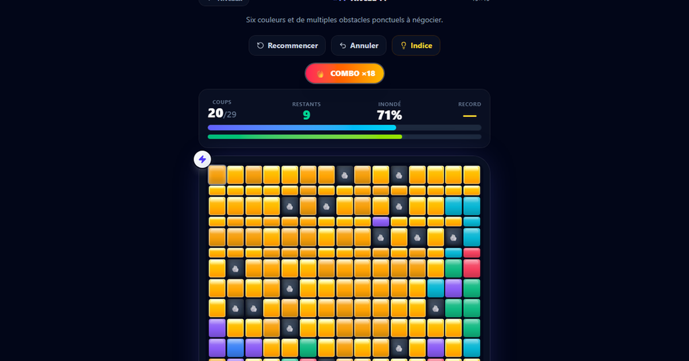

# Tache d'Huile

**Le puzzle qui se répand. Inondez le plateau depuis le coin, en un minimum de coups.**

Joue ici : [games.hylst.fr/tachedhuile/](https://games.hylst.fr/tachedhuile/)



## Comment on joue

Votre territoire commence sur une seule case, en haut à gauche. À chaque coup, vous choisissez
une couleur : tout votre territoire prend cette couleur, et absorbe au passage les cases
voisines qui portaient déjà cette couleur. Comme une tache qui s'étale.

Le but : couvrir tout le plateau avant d'épuiser vos coups. Plus vous finissez vite, plus vous
gagnez d'étoiles.

Les rochers 🪨 ne s'inondent jamais : ils découpent le plateau et vous obligent à contourner.

## Deux modes

**Mode Aventure** — 24 niveaux répartis en 4 chapitres, débloqués au fur et à mesure. La
grille grandit (6×6 jusqu'à 20×20), les couleurs passent de 3 à 6, et les rochers dessinent
des motifs de plus en plus retors : centre, coins, croix, pointillés, labyrinthe.

**Mode Libre** — trois tailles (8×8, 12×12, 16×16), six couleurs, aucun obstacle, et votre
meilleur score enregistré par taille.

## Contrôles

| Action | Effet |
|--------|-------|
| Clic sur une couleur | Joue ce coup |
| Touches 1 à 6 | Même chose au clavier |
| Z | Annule le dernier coup |
| H | Indice (surligne le meilleur coup immédiat) |
| R | Recommence le niveau |

Survoler une couleur affiche un aperçu : les cases qu'elle ferait gagner s'allument, et un
badge `+N` indique combien.

## Ce qu'il y a dedans

- 24 niveaux avec 6 motifs d'obstacles différents, tous garantis jouables
- Système de combo qui s'emballe quand vous enchaînez les gros gains
- Étoiles (1 à 3) selon le nombre de coups par rapport à la limite
- Aperçu du gain au survol, indice, annulation
- Musique d'ambiance et effets sonores générés à la volée en Web Audio
- Progression, étoiles et scores sauvegardés en local

## L'arborescence

```
tache-d-huile-game-development/
├── index.html          # template + bloc SEO
├── vite.config.ts      # base '/tachedhuile/' + singlefile
├── public/
│   ├── favicon.png
│   ├── og-image.png / og-image.webp
│   └── icon.webp        # carte du menu, 128x128
└── src/
    ├── main.tsx
    ├── App.tsx           # ecrans, etat de partie, plateau, palette
    ├── game/
    │   ├── flood.ts      # LOGIQUE PURE : generation, flood fill, score, indice
    │   ├── levels.ts     # les 24 niveaux de la campagne
    │   └── audio.ts      # synthese Web Audio
    ├── components/       # LevelSelect, Confetti, ParticleBurst, FloatingGain...
    └── index.css         # Tailwind + animations
```

## Dev

```bash
npm install
npm run dev       # http://localhost:5173/tachedhuile/
npm run build     # dist/index.html, un seul fichier
npm run preview
```

## Stack

React 19, TypeScript 5.9 (strict), Tailwind CSS 4, Vite 7, vite-plugin-singlefile,
lucide-react.

Zéro backend, zéro image : tout est du CSS et du SVG, les sons sont synthétisés au vol.

## Licence

AGPL-3.0-or-later, Geoffroy Streit (Hylst). Voir `LICENSE`.
